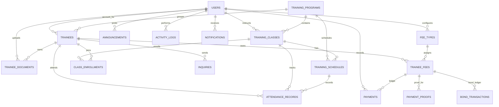

# LSI SmartTrack System Design

## Purpose

LSI SmartTrack is a QR-enabled attendance and TESDA trainee monitoring system for Mindoro State University, College of Computer Studies. The application has three account roles: trainee, instructor, and administrator/staff.

## Functional Requirements

| Role | Features |
| --- | --- |
| Trainee | Sign in/out; change password; update profile; view and print QR ID; view attendance history and present/late/absent summary; upload and retrieve personal requirements; view balances, payment history and receipts; submit private payment proofs; view announcements; send inquiries and read replies. |
| Instructor | Sign in/out; change password; update profile; view assigned classes and trainee lists; scan or manually enter QR IDs for time-in/time-out; view live class attendance; correct attendance with remarks; see absence alerts and follow-up lists; generate and export daily, weekly, and monthly reports; upload class documents; post announcements; reply to inquiries. |
| Administrator / Staff | Manage user accounts and roles; reset passwords and deactivate accounts; manage trainee and instructor records and QR IDs; manage programs, classes, schedules, and instructor assignments; record and monitor attendance; manage absences and reports; configure program/class fees; record and reverse payment ledger entries; verify proofs and process bond refunds/forfeitures; export collection and outstanding reports; classify, retrieve, and secure documents; configure versioned completion-certificate templates; review eligibility and issue or revoke certificates; manage announcements and inquiries; review activity logs. |

## Sitemap

```text
Sign in / First-run administrator setup
└── SmartTrack portal
    ├── Dashboard
    ├── Attendance
    │   ├── Live class attendance
    │   ├── QR / manual check-in and check-out
    │   ├── Attendance history and corrections
    │   └── Reports (daily / weekly / monthly / CSV)
    ├── Trainees (records, profile, QR ID, documents, attendance)
    ├── Training
    │   ├── Programs
    │   ├── Classes and instructor assignments
    │   └── Schedules and enrollments
    ├── User accounts and roles (administrator/staff)
    ├── Documents (upload, classify, retrieve, access control)
    ├── Payments (fee setup, cashier, proof review, bonds, reports)
    │   └── My payments (balances, proofs, receipts)
    ├── Announcements
    ├── Inquiries and replies
    ├── Activity log (administrator/staff)
    └── My profile (profile and password)
```

## Initial Interface Wireframes

### Sign in

```text
+--------------------------------------+------------------------------+
| LSI SMARTTRACK                       | SECURE ACCESS                |
| Every session,                       | Welcome back                 |
| accounted for.                       | Username                     |
|                                      | Password                     |
| Campus identity and short intro      | [ Sign in                 ]  |
+--------------------------------------+------------------------------+
```

### Portal dashboard

```text
+---------------------------------------------------------------------+
| LSI SMARTTRACK                              Account / role / sign out|
| Dashboard / date                                                    |
| Active trainees | Active programs | Present today | Follow-up needed|
| Recent check-ins (dynamic attendance table)                         |
| Campus bulletin (published announcements)                           |
+---------------------------------------------------------------------+
```

### Management section

```text
+---------------------------------------------------------------------+
| Navigation | Section title                         [Add record]    |
| Search / filters                                                    |
| Record table: identity | status | related class/program | actions   |
| Selected record form: validated fields / save / cancel              |
| Context actions: scan attendance, upload, reply, print/export       |
+---------------------------------------------------------------------+
```

## Database Design

The SQL schema is provided in `lsi_smarttrack-database.sql`. Passwords are stored as password hashes. File contents are stored outside the public web root; database records hold their private path and access level.

Completion certificate designs are stored as immutable versions in
`certificate_templates`. Each issued certificate stores its template version
and JSON snapshot, so later template edits do not change previously issued
certificates. Uploaded backgrounds and logos are kept under the protected
`runtime/uploads/certificates/templates` directory. Apply the additions in
`lsi_smarttrack-upgrade.sql` before using certificate template settings.
Administrators and staff can load a saved version into the editor; saving
creates a new version. Only inactive versions without issued-certificate
references can be deleted.

Certificate eligibility approval queues a certificate as `pending_signature`
for every active configured signatory. Signatures, timestamps, IP addresses,
and SHA-256 certificate-data hashes are stored in `certificate_signatures`;
signature images stay under the protected
`runtime/uploads/certificates/signatures` directory and are only read by the
PDF generator.

Payments use immutable `payments` ledger rows. Correcting a recorded payment
adds a reversal entry rather than editing or deleting the original. Program
and class fee rules are copied to `trainee_fees` when an enrollment is
synchronized, so later fee-rule changes do not rewrite existing balances.
Uploaded payment proofs are stored outside the public directory under
`runtime/uploads/payment-proofs`; only the trainee who uploaded the proof and
administrator/staff accounts can retrieve it. Verified proofs create a ledger
payment and official PDF receipt. Bond deposits, refunds, forfeitures, and
automatic `refund_pending` clearance transitions are recorded in
`bond_transactions`. Required fee rules can optionally block certificate
eligibility while a balance remains. CSV exports are compatible with Excel;
reports and individual receipts can also be generated as PDFs. Online gateway
payments and webhook verification are not included in this phase.



| Table | Primary key | Main fields and relationships |
| --- | --- | --- |
| `users` | `user_id` | `full_name`, unique `username`, password hash, role, active status, creation time. Instructor assignments and trainee logins reference this table. |
| `trainees` | `trainee_id` | Name, sex, contact, course, program, active status, optional `user_id`, unique QR code. |
| `training_programs` | `program_id` | TESDA program code, program name, description, duration in hours, active status. |
| `training_classes` | `class_id` | Program, instructor user, class name, date range, status. |
| `training_schedules` | `schedule_id` | Optional class/program, date, start and end time. |
| `class_enrollments` | `enrollment_id` | Unique class/trainee pair and enrollment timestamp. |
| `attendance_records` | `attendance_id` | Trainee, class, schedule, date, time-in/out, status, remarks, recording user. |
| `trainee_documents` | `document_id` | Optional trainee owner for institute-level files, optional class, uploader, document label, private file path, upload date, active status, review status and reviewer metadata, access level. Trainee requirement uploads are pending until staff approve or reject them. |
| `announcements` | `announcement_id` | Author, title, content, publication status and timestamp. |
| `inquiries` | `inquiry_id` | Trainee, subject, message, reply, status and timestamp. |
| `notifications` | `notification_id` | Recipient, message, type, read state and timestamp. |
| `activity_logs` | `log_id` | Optional user, action, details and timestamp. |
| `fee_types` | `fee_type_id` | Registration or bond fee rule scoped to a program or class, with amount, due date, and optional certificate eligibility requirement. |
| `trainee_fees` | `trainee_fee_id` | Per-trainee/class fee snapshot and refundable bond status. |
| `payments` | `payment_id` | Append-only collection and reversal ledger, payment method/reference/date, and unique official receipt number. |
| `payment_proofs` | `proof_id` | Private uploaded proof with pending/verified/rejected status and reviewer details. |
| `bond_transactions` | `bond_transaction_id` | Append-only bond deposits, refunds, forfeitures, reversals, and automatic clearance transitions. |

## Local Setup

1. Configure `DB_HOST`, `DB_PORT`, `DB_USER`, `DB_PASSWORD`, and `DB_NAME` in `.env`.
2. For a fresh database, import `lsi_smarttrack-database.sql`. For an existing database that already has `training_programs`, import `lsi_smarttrack-upgrade.sql`; it creates the missing SmartTrack tables and preserves existing tables.
3. Point the web server to the project `public` directory and open the application. First run prompts for the initial administrator; no default credentials are shipped.
4. Configure certificate signatories in Certificate Settings before approving eligibility for signing.
5. Add programs, accounts, trainees, classes, schedules, and enrollments from the portal.

## Deployment

The production deployment uses the `Dockerfile` (Apache with `public/` as the document root and a front-controller rewrite) and `render.yaml`. The database is MySQL and is supplied by an external host. See `docs/RENDER-DEPLOYMENT.md` for the service configuration, the required environment variables, and the verification checklist.

## Demonstration Checklist

- Show this feature list, sitemap, wireframes, and ERD.
- Sign in with the first-run administrator and navigate the portal.
- Add and edit a record, then verify the stored database row.
- Record a QR/manual attendance event and show it in the live list and report.
- Upload and retrieve a private trainee document, publish an announcement, and reply to an inquiry.
- Demonstrate invalid form handling and the confirmation step before deletion.